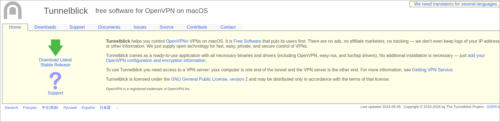
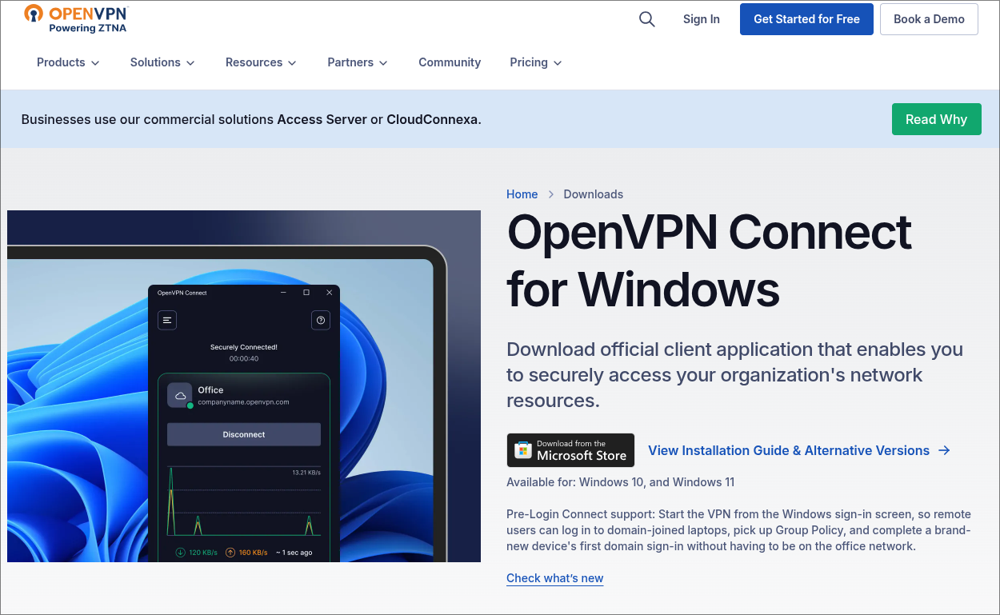

# **VPN-Cath-Bypass-2 (VPN)**
 **INSTRUCTIONS**

**Note that i am currently attempting to make a script that will automatically run and do all this - untill then do it manually**

**If your not techy or cant figure it out, just give this entire thing to claude or chatgpt and it should be able to help**

This vpn was made and editted based on other openvpn files - 

 ## **SECOND VERSION OF THIS IS NOW UPDATED, PORT 443 AND MTU 1400 CHANGES MADE - REDOWNLOAD TO GET WOKRING**

## 1.

 You will need a service to run the VPN config, if you just want basic access. This is a list of services i would suggest:
(Feel free to find, make, or use your own)

## **MacOS / Mac device:** Tunnelblick

## **Windows:** OpenVPN Connect
Note that this works for most OS's

## **Linux:** Run it through your nmcli or nmtui (depending on preference). Will release my .dotfiles and more at a later point
(You can figure it out, i believe in you)

## 2. 

Download the VPN config. I added and did some features to try and ensure that the wifi won't immediatly decline the offer to connect, as well as some quality of life changes.

Note this may not be permamently avalible.

[Download file](vpn_source_singapore.ovpn)

## 3

 install the config on whichever GUI u decided on, and enter the user and password required for the config.

user: SOWoouLkbWurxsve

password: 4Q15sWANPbRJBBHh4a33dK46Cz1jjshu

# enjoy
#
#
#
#
#
#

 **First Notes:**

the current system of the wifi works by having cert based authentication.
(this just means that your device needs to present information to the wifi for it to let you in)

The network shows a certificate to your device, but in return you have to return one aswell.

You will likely need your own files to be able to properly bypass. This current works on the base wifi.
If you need directions on how to edit and use the files, keep scrolling.

 **Still not working?**      (this gets more complex)

Problem

Unable to connect to EAP-TLS WiFi network "TCS" using .p12 certificate

Causes of the issue:

1. Legacy .p12 Encryption: Original certificate used RC2-40-CBC (deprecated/weak)
2. Path-Space Bug: NetworkManager failed to handle spaces in certificate file paths correctly for private-key property
3. Missing Wireless Security: Required 802-11-wireless-security.key-mgmt=wpa-eap not set
4. Incorrect Password Usage: Both 802-1x.password and 802-1x.private-key-password set (only latter needed for .p12)
5. Property Order Dependency: Must set 802-1x.eap=tls before configuring certificate properties

here is a list of what will be needed for you to continue with this guide, if it didnt work off rip:

## list of things that i did to make the vpn functional

 1. Cert file requirements

- CA Certificate: PEM format file in cert storage
- TLS-crypt: PEM format file in cert storage
- Client credentials: Username and password stored in the VPN connection (see above)
- Proper permissions: Certificate files readable by your GUI / user / device (ENSURE THAT THE .pem / .cert FILES ARE NOT OUTDATED!!!)

 2. Config

- Unique (only one of the working connection, dont have multiple - delete one if u fuck it up)
- Correct UUID: script (if thats what your using to run the config) must reference the UUID of the working connection
- Service Type: Must be org.freedesktop.NetworkManager.openvpn for OpenVPN (note that this is based of my linux setup, will be different on your device.)

 3. Script Requirements

- Should be handled by your GUI - if not and your on linux, good luck (see my .dotfiles)

 How to convert your existing certificate to modern

**note you need to change some of the commands to work for your device**
**This is for a linux device running arch**

Certificate Conversion (Legacy → Modern)

 Extract CA certificate (with legacy flag for RC2-40-CBC)
openssl pkcs12 -in "/home/user/Downloads/Cathedral School Root CA-TCS-User-**(YOUR IDENTIFY GOES HERE)**@school.cathedral.qld.edu.au.p12" -nokeys -out tcs-ca.pem -legacy

 Extract private key (with legacy flag)
openssl pkcs12 -in "/home/user/Downloads/Cathedral School Root CA-TCS-User-**(YOUR IDENTIFY GOES HERE)**@school.cathedral.qld.edu.au.p12" -nocerts -out temp-key.pem -legacy -passin pass:abcd1234

 Remove passphrase from key
openssl rsa -in temp-key.pem -out client-key.pem -passin pass:abcd1234

 Create modern .p12 (AES-256-CBC encryption)
openssl pkcs12 -export -out "/home/user/Downloads/Cathedral School Root CA-TCS-User-**(YOUR IDENTIFY GOES HERE)**@school.cathedral.qld.edu.au-modern.p12" -inkey client-key.pem -in tcs-ca.pem -password pass:abcd1234

 Cleanup temp files
rm temp-key.pem

Path-Space Workaround

 Create symlink directory
mkdir -p ~/certsymlink

 Create symlink without spaces for private-key property
ln -s "/home/user/Downloads/Cathedral School Root CA-TCS-User-**(YOUR IDENTIFY GOES HERE)**@school.cathedral.qld.edu.au-modern.p12" ~/certsymlink/tls-cert.p12

 CA cert also placed in symlink directory (no spaces in this path)
cp tcs-ca.pem ~/certsymlink/

NetworkManager Connection Configuration

 ADD connection (critical: set EAP type FIRST)
nmcli connection add type wifi ifname wlp0s20f3 con-name "TCS-EAPTLS-MODERN" ssid "TCS"
                                     (will need yoru own device wifi name here)

 SET 802-1X properties (order matters!)
nmcli connection modify "TCS-EAPTLS-MODERN" 802-1x.eap tls
nmcli connection modify "TCS-EAPTLS-MODERN" 802-1x.identity "**(YOUR IDENTIFY GOES HERE)**@school.cathedral.qld.edu.au"
nmcli connection modify "TCS-EAPTLS-MODERN" 802-1x.ca-cert "/home/user/certsymlink/tcs-ca.pem"
nmcli connection modify "TCS-EAPTLS-MODERN" 802-1x.system-ca-certs yes
nmcli connection modify "TCS-EAPTLS-MODERN" 802-1x.client-cert "/home/user/Downloads/Cathedral School Root CA-TCS-User-**(YOUR IDENTIFY GOES HERE)**@school.cathedral.qld.edu.au-modern.p12"
nmcli connection modify "TCS-EAPTLS-MODERN" 802-1x.private-key "/home/user/certsymlink/tls-cert.p12"  # SYMLINK (no spaces)
nmcli connection modify "TCS-EAPTLS-MODERN" 802-1x.private-key-password "abcd1234"

**password for all certs will be "abcd1234" - will work for yours aswell.**

 CLEAR incorrect password property (not needed for .p12 auth)
nmcli connection modify "TCS-EAPTLS-MODERN" 802-1x.password ""

 SET wireless security (required for WPA-EAP)
nmcli connection modify "TCS-EAPTLS-MODERN" 802-11-wireless-security.key-mgmt wpa-eap

 ACTIVATE connection
nmcli connection up "TCS-EAPTLS-MODERN"

 Results in a working connection: TCS-EAPTLS-MODERN 

## If that STILL doesnt work:

firstly, your a bum. 

Secondly, text me.

Much love
